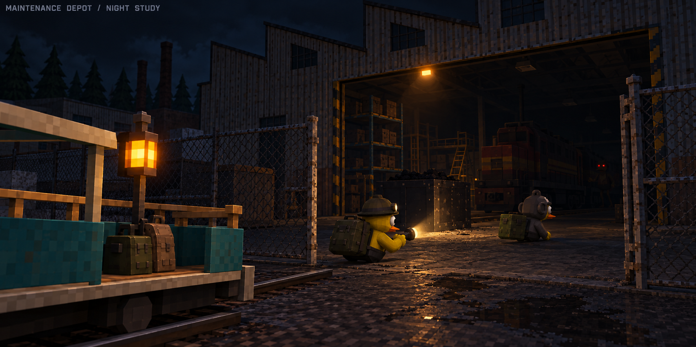
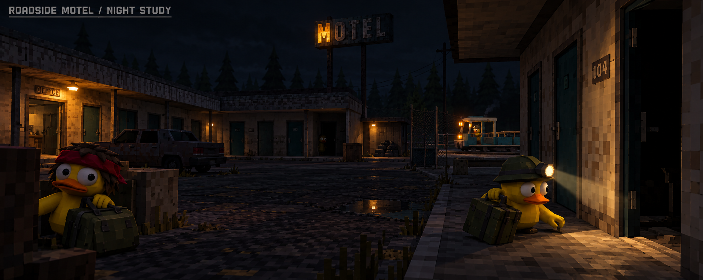
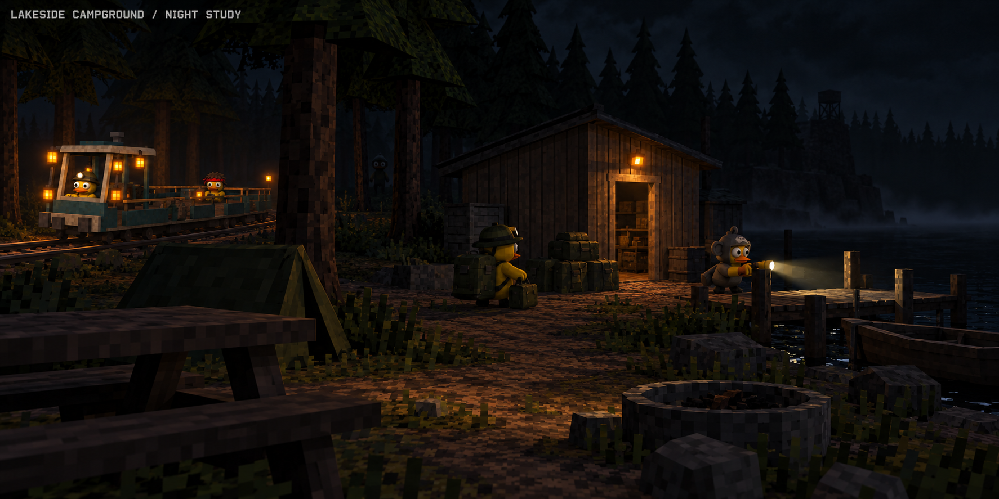
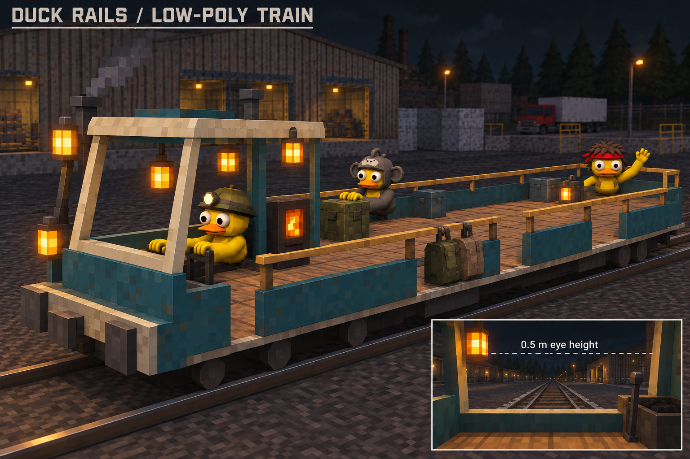
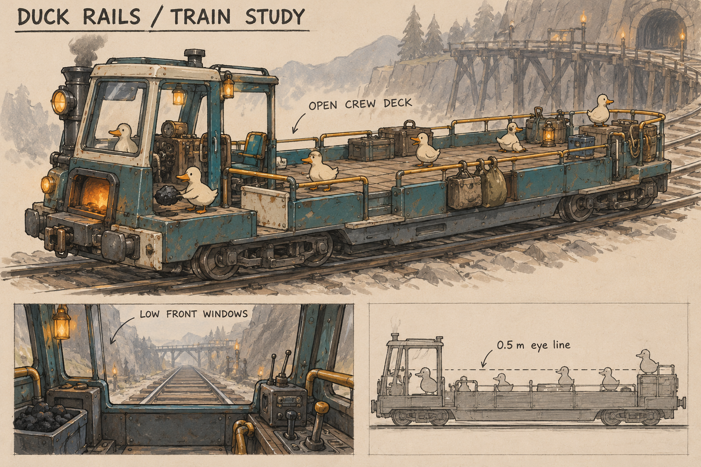
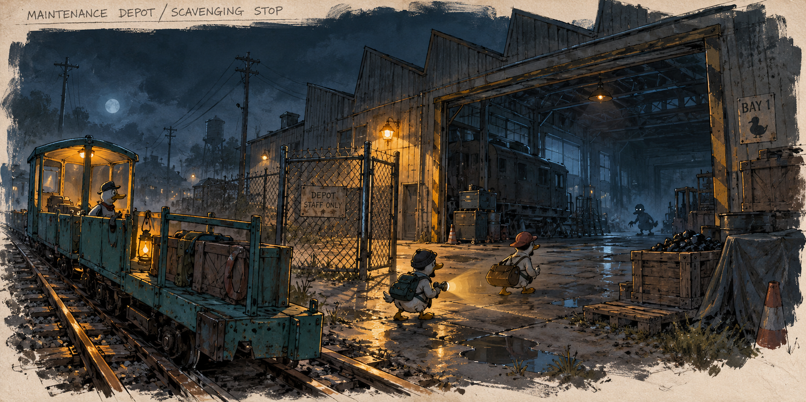
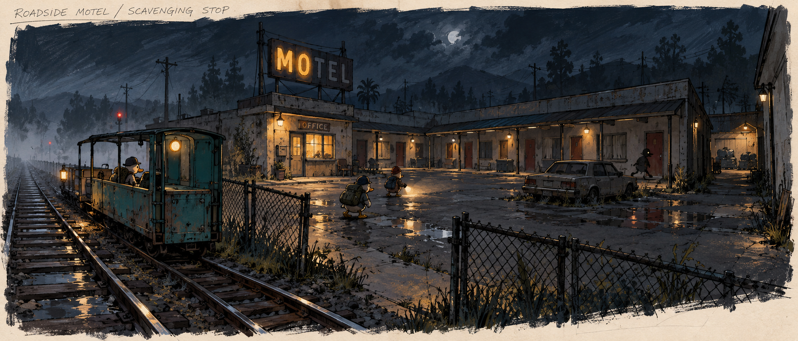

# Duck Rails rough art concepts

November 2: [Maintenance Depot prototype study](maintenance-depot-prototype.md) adds rough arrival/interior renders and a labeled top-down diagram. Review the proposed layout before greyboxing, then make the first art pass after the greybox. The generated overhead failed twice; the supplied plan is a deterministic diagram.

October 30, 2026. Concept explorations using the [art guide](art-guide.md), generated with the built-in image generation tool. These are visual proposals, not production meshes, measured plans, Unity captures or performance results. The user endorsed the low-poly train look and requested darker, spooky nighttime locations. Preserve existing DuckZ character identity in production.

## Compound alternatives — November 1, 2026

The user approved banking the [outdoor compound concept](../output/imagegen/duck-rails-compound-outdoor-approved-v1.png) as the outdoor alternative, then requested an additional, more cramped and apocalyptic refuge inside an abandoned subway terminal. This is not a decision to replace the outdoor version or implement either scene.

Outdoor direction: low-poly geometry and pixelated textures; rundown brick/timber station and enlarged supplies store facing the common space; open walk-through bay on the store; station information beside the platforms gate; blank wall reserved for in-game private-session controls, without Create/Join signs or doors. Continuous fortified walls have taller sections, corrugated-metal repairs and retrofitted swivel searchlights above the wall with exposed cables. A broken central fountain holds shallow water. Cold courtyard light and faint warm interiors preserve safety within a scary world. Forest and abandoned town lie beyond the perimeter. No train is visible in this pre-platform hub.

Subway exploration brief: retain station information, platforms access and supplies, compress them into an abandoned underground terminal, and make the refuge feel assembled ad hoc from salvaged materials. Preserve low sightlines and clear entries. Exact layout is a proposal pending image review. Neither concept is a production mesh or validated gameplay layout.

Generated with the built-in image tool; the outdoor image is an appearance reference, not Unity implementation evidence.

[Subway terminal exploration v1](../output/imagegen/duck-rails-compound-subway-v1.png): proposed cramped concourse with salvaged partitions, station information left, barricaded platforms ahead and walk-in supplies right. Review pending; the rendered detail remains denser than the intended economical game meshes. [Generation prompt](../output/imagegen/duck-rails-compound-subway-v1-prompt.json).

Subway user review, November 1: the user endorsed this concept. Railway tracks lie behind the left and right walls, inaccessible to players but audible from the terminal. Behind the concept camera, stairs lead up toward the outside; makeshift crates and panels completely block this route. This is a sealed environmental boundary, not an accessible exit or a barricade-removal objective. The platforms remain the departure destination. Specific tunnel sound events and their timing remain proposals. These decisions describe the concept, not implemented geometry or audio.

The user also approved the [reverse stairway concept](../output/imagegen/duck-rails-compound-subway-reverse-v1.png) and authorized a walkable Unity blockout. See [subway implementation and evidence](subway-compound.md); finished art and headset acceptance remain pending.

## Dark nighttime location studies

User review, October 30: the latest Maintenance Depot, Roadside Motel and Lakeside Campground night renders, together with the low-poly train render, are approved as the visual direction. This endorses their look and atmosphere; exact layouts, dimensions, production meshes and target-device performance still require implementation and review.

The approved train image and supplied DuckZ avatar/environment screenshots anchor the style: economical polygon shapes and visibly pixelated textures. These three studies explore lower ambient light, isolated practical lamps and flashlight reveals. Their detailed layouts and lighting remain proposals. Near paths stay readable while distant interiors, trees and water fall into shadow; target-headset visibility still requires an in-game review.

### Maintenance Depot at night

The crew leaves the train for a dim repair bay, with a coal crate near the entry and an uncertain threat farther inside. Warm light marks the return route while the warehouse depth stays dark.

### Roadside Motel at night

A courtyard view puts a dark room entrance close to the player and the train farther away through the fence opening. Sparse doorway lights leave unlit gaps to cross.

### Lakeside Campground at night

A supply cabin, dock and black lake create a different kind of exposure. The flashlight reveals the dock while trees interrupt the view back to the train.

The [night-study prompts and reference paths](../output/imagegen/duck-rails-night-locations-v1-prompts.json) are saved with the images. These replace the earlier environment paintings as the current visual style studies; the originals below remain useful as layout history. No 3D or Unity changes were made.

## Train

### Five-view turnaround and material atlas

The [turnaround supplement](../output/pdf/duck-rails-train-turnaround-and-atlas-v6.pdf) contains front, back, right side, top and rear-right three-quarter concept views, plus a separate [16-tile texture atlas draft](../output/imagegen/duck-rails-train-texture-atlas-v1.png). The [view sheet](../output/imagegen/duck-rails-train-turnaround-v6.png) follows the v5 package's station arrangement: furnace left, radio right, empty centered cockpit and open rear. Perspective-specific visibility was reviewed and refined. These generated views are not measured projections of a common mesh. Final topology, UV binding and atlas padding remain unbuilt. [Prompts](../output/imagegen/duck-rails-train-turnaround-v6-prompts.json) preserve the generation/refinement history.

### Production study

The current [train production study](train-production.md) is revision 3: a four-page PDF with proposed deck layout and height diagrams, revised top view, cockpit, and approved radio/furnace prop detail. Both stations sit outside the cockpit, the stack rises directly into open sky, rear bags are removed, and the trailing edge is open for boarding without a rear rail. The user approved the simplified receiver and centered seat/throttle with fuel left and horn right. Keep the headlight, two cockpit side lamps and mic-base TALK button. No hanging lamp or decorative coal. Use the dimensioned plan and written brief for placement; generated images remain illustrative. Earlier in-cockpit station and loaded rear-rack layouts are superseded.

### Low-poly style revision

October 30: the user confirmed that Duck Rails should match DuckZ's existing low-poly meshes and pixelated textures. The supplied avatar screenshots, app icon and Quackville environment captures are the style references. The following generated image preserves the open-deck idea while exploring simpler geometry, coarse textures, low windows and DuckZ-style legless avatars. The furnace is moved to a side position in this concept to clear the forward view; this is a proposed art arrangement, not an implemented interaction change.

This image resembles a 3D game render but is an AI-generated concept, not a 3D model, Unity capture or performance result. Exact sightlines, capacity and dimensions still need validation. [Reference roles and prompts](../output/imagegen/duck-rails-train-low-poly-v2-prompts.json) are saved alongside it. The earlier environment paintings below remain mood/layout studies; their painterly materials and bird placeholders are superseded by the DuckZ style direction in [Art Guide v0.3](art-guide.md).

### Original shape study

Explore the mostly open-air crew deck and small front shelter. The sheet includes a low driver view and a 0.5-metre eye-line reference. Window, rail, nose and dashboard dimensions still require review in the existing player rig; the sketch is not proof of visibility or eight-player clearance.

## Maintenance Depot

A warm train beside a cold repair yard. An open gate and large maintenance bay draw the crew off the train toward supplies, with darker space behind the visible coal. The train remains the return landmark.

## Roadside Motel

A courtyard, repeating room doors and a service passage offer a more exposed approach and multiple places to investigate. The large motel sign establishes location identity; the waiting train anchors the return route.

## Next review

Review silhouette, low-eye-line visibility, openness, atmosphere and the invitation to explore. Train details vary between the environment thumbnails and the dedicated sheet; the dedicated train study is the starting point for the next consistency pass. No depicted layout or decorative feature supersedes the confirmed gameplay and authored block contracts.

The exact [generation prompts](../output/imagegen/duck-rails-concept-prompts-v1.json) are saved with the images for revision. No 3D or Unity work was performed for this deliverable.

## Coal pickup art — November 5, 2026

User approved the fractured charcoal concept and requested implementation. The shared `Assets/Resources/Rails/RailCoal.prefab` now uses the authored 44-triangle mesh and 32x32 point-filtered charcoal pixel texture in `Assets/DuckRails/Coal/`. Broad faces, an uneven crown and a chipped lower shoulder replace the grey cube. No emission; matte URP material. Mipmaps retained for distance stability, texture uncompressed.

The existing 0.3 root scale, 0.6 kg rigidbody, box collider, held-locomotion collider reference and Photon components are retained. The visible lump is approximately 30 x 25.5 x 30 cm, with its bottom aligned to the existing collision box; the simple collision envelope remains slightly larger around the chipped corners. GrabSurfaceBaker regenerated coal's precise hand-contact surface from the new mesh. The Week 2 builder retains these art assets when regenerating coal.

Rebuild with `Duck Rails/Art/Build Approved Coal` (`Assets/Editor/RailCoalArt.cs`). The editor-only authoring code generates saved assets; there is no runtime mesh or texture generation.

Validation: Unity compilation passed; saved prefab inspected; existing GrabSurfaceChecks passed 927 assertions across 11 prefabs, including coal interior selection and contact geometry. Evidence: [editor checks](validation/coal-art/editor-checks.txt), [Unity asset preview](validation/coal-art/unity-preview.png), [approved concept](validation/coal-art/approved-concept.png). Preview is an isolated Unity render, not gameplay lighting. Headset/nighttime readability and natural interaction remain unverified; this art pass does not close multiplayer/headset milestones.
