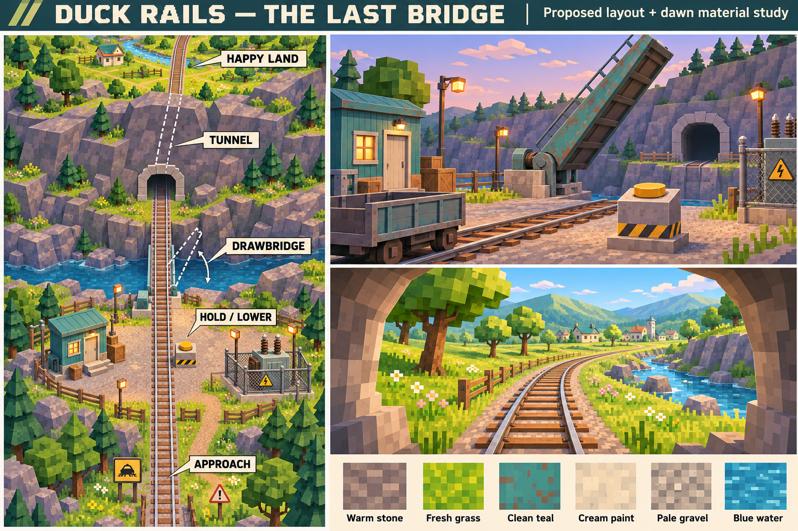

# Final escape block — concept V1

## Fortress encounter refresh — November 17, 2026

**Scoped live follow-up:** one authenticated Unity editor run passed November 17:
both tower enemies naturally reached the control approach at 11.415 seconds of
holding, the third appeared at the 30-second threshold (observed at 30.209 s) and
also reached controls, and the bridge finished at exactly 60.000 seconds with a
horizontal deck. No enemy teleport discontinuities detected. Test operator was
invincible, using the real physical lever fixture; combat balance, real-peer
replication and headset/build acceptance remain queued. See
[trace](../output/bridge-finale-live/trace.txt) and [playtest results](playtest-queue.md#bridge-defender-approaches-and-60-second-hold--pass-scoped-2026-11-17).

User requested navigation/loot updates for the new environment, build lighting,
60 seconds of accumulated lever holding, and a 30% midpoint increase **only to
bridge defenders**. Two initial defenders therefore become three (rounding up):
one reinforcement at 30 seconds of actual lowering, not elapsed wall time.
Release retains progress. The retained run snapshot records the wave count and
trigger; master replacement/resume cannot recalculate it. Room spawn markers
deduplicate creation. Replay resets the trigger. The extra zombie starts on the
west upper deck at (-22, 8.05, 74), separate from the initial selection pool.

Finale defenders now path toward a point just south of the control cabinet when
not chasing/searching for a player. Normal perception, pursuit, hit reactions,
flare retreat and boarding rules retain priority; this does not make enemies
see players through walls. The objective is reconstructed from room spawn data
after authority changes. Matchmaking suffix advances to `-tower-finale-v2` so
old 30-second builds cannot share these runs; rebuild all participating clients.

- Offline graph rebaked against the saved current bake scene: **73,371 nodes**,
  656,236 edges. Both initial tower defenders and the reinforcement have complete
  floor-only paths to the control approach (34, 36 and 25 path nodes).
- **28 coal / 26 gold candidates**, still **6 coal / 2 gold per run**. Eight
  truck-bed candidates per type are retained; remaining candidates redistributed
  across parade/loading terraces, bunker interiors/roof, upper decks/towers,
  east bastion/colonnade and yard climb blocks. Existing marker identities and
  nested prefab references are retained. Ready for user inspection.
- Exported the user's latest lighting bake: **three lightmaps, 1,311 renderer
  bindings, 498 probes and 69 captured baked fixtures**. Companion contains only
  the probe root and remains enabled in Build Settings. Expedition inherits the
  updated prefab, with no missing binding references. Moving bridge/terminal and
  unlit text remain outside static lightmap export. No lighting rebake was needed
  after marker-only placement changes.

Validation: compilation, 1,652 scoped EditMode checks (physical loot support and
clearance, positive overlap control, 100 seeds/type, complete enemy paths, timing,
wave retention and lighting references), bridge-hold, Week 2 and bridge-terminal
regressions pass. Existing CutePixel missing-em-dash warning remains. No Play Mode
or player build was run; actual build/headset lighting and natural encounter
behavior are **queued for playtest**, not verified. Reproducible checks:
`RailFinaleRefresh.Check()` in the finale bake scene. Evidence:
[checks](../output/bridge-finale-refresh/checks.txt),
[placements](../output/bridge-finale-refresh/placement-plan.txt).
The pre-edit unsaved scene was preserved at `output/bridge-finale-refresh/before.unity`.
All three approach paths also reach their goal using the runtime pathfinder's
4,000-expansion/three-cluster budget. This is navigation evidence, not proof of
natural enemy locomotion or encounter difficulty. Console error/exception query
was empty. Scoped diff whitespace checks pass with Unity's generated blank-value
line endings excluded; unrelated working-tree whitespace was left untouched.

## Low bridge lever terminal — November 16, 2026

Bridge alarm follow-up: `BridgeAlarmBeep_Reverb.wav` is a separate spatial one-shot on the retained bridge control anchor (`RailBridgeAlarm`), routed to effects. First active lowering beeps immediately; subsequent starts require four seconds of monotonic real time since the last beep. Release/re-grab and component disable retain the cooldown; missed intervals never accumulate. Idle/completed bridge cannot start a beep. Release permits the baked tail to finish; disable stops playback. Existing zone reverb is bypassed for this already-reverberated source. Initial volume 0.65, linear range 5–80 m; listening remains queued.

User approved the shallow olive wedge concept and requested Blender construction,
train-throttle hand snapping, integrated 0–100% progress and mechanical lowering
audio. Installed on the existing `Env/Lower bridge button` anchor, retaining its
identity and all route/Expedition references. This supersedes the floor-button
presentation below. The old button is inactive; the gold deposit remains at its
existing position immediately beside the terminal. No rear cable or pedestal.

- Editable source: `ArtSource/BridgeTerminal/BridgeTerminal.blend`, reproducible
  with `build.py` using installed Blender 5.3 in background mode (live MCP was
  unavailable). Two Blender mesh exports become Unity mesh assets through
  `RailBridgeTerminalArt.Install()`. Cabinet + moving lever: 2,322 triangles,
  one pixel atlas/material, plus two simple display bars and CutePixel text.
- Cabinet footprint 1 × 0.94 m including flange; top rises from about 0.08 to
  0.38 m. Grip centre is 0.4485 m above the platform at either end stop, matching
  the train's approximately 0.45 m reference. Grip collider, palm offset,
  acquisition/snap path, 70-degree tracked-palm arc, breakaway, forward detent
  and quarter-second return reuse `RailControl`. Like the train control, it
  does not create a hand-locomotion wall. Keyboard simulation uses physical
  reach/grip, not the train's T shortcut.
- Lever feedback uses the exact train audio bank and `RailControl` sound path:
  `Throttle_Grab`, quarter-travel `Throttle_Click` cues with the same rising
  pitches, `Throttle_Latch` at full-forward engagement, and `Throttle_Release`
  plus descending return clicks on letting go. Full-forward means 100% lever
  travel, independent of the bridge completion percentage. User explicitly
  confirmed this parity; shared code and all four asset references checked in
  Edit Mode. Listening remains queued alongside the separate lowering loop.
- `RailHoldControl` reads the forward-held lever and publishes the existing
  expiring, run-scoped bridge hold. Release/pullback pauses retained progress;
  no drive lease or train throttle request is sent. Existing master checks for
  nearby hands, participant state and being outside the train remain. First
  valid hold still triggers the existing two tower defenders.
- `RailBridgeTerminal` reads the exact shared `BridgeProgress` used to pose the
  bridge; the bar tracks it continuously and whole-number percent floors until
  actual completion (never displays 100% early). Release retains both displays.
  User-selected `Assets/Audio/Bridge/BridgeLower_Loop.wav` replaces the synthesized
  loop. Spatial playback routes through the effects mixer and follows shared
  `BridgeMoving`. Start ramps volume from silence and pitch from 0.55 to 1 over
  0.18 s; stopping fades volume and pitch back down over 0.22 s before stopping
  playback. Quick stop/resume reverses from the current blend without restarting
  the playhead. Pause, completion, expiry and finish use the stop tail; disable
  stops immediately. Late join reads current state. These timings are initial
  tuning for the user's requested quick mechanism spin-up/down, listening queued.

Validation: Unity 6000.3.24f1 compilation; 27 terminal, 17 retained bridge-hold and
27 train-drive EditMode checks pass. Saved Expedition inherits exactly one
terminal and its lever reference without a scene rewrite. Gold transform,
CutePixel font, non-solid grip, end stops, progress boundaries and loop import
checked. [Evidence](../output/bridge-terminal/checks.txt) and
[installed Unity preview](../output/bridge-terminal/unity-installed.png).
Preview uses temporary review lighting and 47% display; it is not a gameplay
capture. One existing CutePixel em-dash warning from `BRAKE NOW` remains.
No navigation or lighting rebake needed: no new solid navigation obstacle;
terminal renderers use existing probes and the display is unlit.

**Queued for playtest:** headset reach/snap/release, sound quality and loop seams,
real-client stop/resume, competing operators, late join/master handoff, first-hold
defenders, completion/crash/replay and the updated production-grip test fixture.
No Play Mode or multiplayer run was performed.

## Batch level polish — November 11

Tunnel corrections after review: restore floor/drawbridge visibility after bake exports, then include the static 70×50 m far bank in lightmapping with probe fallback disabled. A single warm probe had coloured the whole grass surface. Local entrance illumination now bakes onto the bank; the user's current 22 lights are preserved, including five tunnel point lights. One finale bake/export, 1,741 bindings installed into Expedition and 23 scoped editor checks pass. Actual night-to-dawn/headset review remains queued; see checklist items 22–23.

Authorized follow-up items 17–21 are installed: finer ground subdivision and lightmap scale, two 0.2 m-thick middle slabs, four independently movable floodlight groups, a dark bank edge with overlapping faces removed, and both low perimeter walls continued to Z80. One coordinated lighting bake/export, 72,503-node navigation bake and 1,862 editor checks pass. No Play Mode; gameplay/headset acceptance remains queued. [Follow-up evidence and views](level-polish-batch.md#follow-up-execution-result--november-11).

The user approved [this measured proposal](../output/level-polish-batch/layout-review.png) and execution of all 16 collected requests. The current prefab was adapted without running the original whole-block builder. Existing traffic/post changes and the two first-hold tower defenders are retained.

All ten stair flights are now smooth ramps. South access turns inward (4 m run / 2 m rise); upper ramps shorten to 8 m run / 4 m rise. Middle ramps retain 8 m runs and river recovery retains both 19.5 m switchbacks per side. Sixty-four recovery posts extend onto the ramps with unchanged handrail tops. Eight climb blocks, fourteen crates in twelve asymmetric groups, two low approach walls, joined concrete surfaces, four three-lamp floodlight arrays and ten emissive red warning caps are installed. The fixtures add fourteen baked spotlights (eighteen total including retained samples).

The manmade tunnel retains its clear envelope and Z120–160 timing footprint, surrounded by grounded faceted cliffs extending into the side hills. Valley water is a single continuous recessed surface at Y-0.25 with a solid bed approximately Y-0.6; the previous underlying flat slab is removed from the valley. Four cottage gables are closed and the victory railway has a gravel bed. No train, route, bridge-hold, networking or enemy-behavior code changed.

Retained 28 coal / 26 gold / six enemy candidates, with two active tower markers and 6 coal / 2 gold / 2 enemies per run. Only the two coal candidates formerly on the shortened upper stair runs move to adjacent flat roofs (X±23, Y4.2, Z62); identities and pool order remain.

Navigation rebaked (72,306 nodes); both tower markers have nearby ground nodes and floor-only paths to the button. Lighting baked/exported and Expedition bindings installed (1,740 receivers). 1,375 scoped geometry/spawn checks and 398 final bridge-sweep/clearance/reference checks pass. Console error query is empty; captures retain a pre-existing CutePixel missing-em-dash warning. Review images use neutral temporary lighting except `baked-fortress.png`, which uses actual bake-scene lighting. Comparable serialized mesh counts are 37,992 triangles / 1,900 renderers versus 32,274 / 2,009 before: fewer renderer objects but 5,718 more triangles, primarily the recessed ground. This is not device performance evidence.

Implementation and detailed evidence: [batch checklist](level-polish-batch.md#execution-result--november-11). Gameplay, headset traversal/readability, multiplayer and Quest performance are **queued for playtest**. No Play Mode was entered.

## First-hold tower defenders — November 11

The first valid bridge-button hold now activates exactly two finale enemies, one in each lookout tower. Reuses the retained `bridgeAt` trigger and master-only room-object spawning with run/marker deduplication; release/repress does not request another wave. The two active markers are at block-local (-34, 8.05, 74) and (34, 8.05, 74), facing inward. Four former candidates remain disabled for reference; six retained candidates, two eligible, two per run. This replaces the five-enemy finale selection; ordinary scavenging counts are unchanged.

Both default to `RailZombie`. Select either named tower marker under `Enemy Spawns` and change **Rail Enemy Spawner > Enemy Type** to tune it. Random uses the seeded mix. The override applies to fixed finale/authoring selection, not scavenging crew selection. Updated clients use the `-tower-finale-v1` matchmaking suffix.

EditMode checks passed: four floor-support corners and body clearance per tower, nearby baked ground nodes and connected ground paths to the button, 100 seeds on both saved prefab and live Expedition instance, retained first-hold serialization/reset and all 17 bridge-hold checks. Compilation completed; Console contained an unrelated Unity Connect token-exchange error. No navigation/lighting rebake or Expedition scene save was needed. Live multiplayer, repeat presses, host handoff, late join and headset defense balance are **queued for playtest**, not verified.

## Loot placement — November 10

Added 28 coal and 26 gold candidates to the empty pools: eight truck beds on the approach, both south/north bastions, side patrol walls and lookout towers. All are before the bridge finish line. Retained fixed **6 coal / 2 gold per run** and existing enemy candidates. Six proposed fortress points were rejected for obstruction. No geometry, navigation or lighting rebuild was needed.

Saved markers, physical envelopes, 100 seeds per loot type and an assembled eight-player route pass EditMode checks; see [evidence](validation/special-block-loot.txt). The finale is left open in Prefab Mode for inspection. Physical settling, reach, balance and real-client acceptance remain queued for playtest. Gold still pays only at shop deposits; no finale payout or train safe was added.

## Steel drawbridge and river recovery — November 6

User requested finished bridge geometry, walls closing the exposed riverbank gaps, and escape stairs on the fortress bank only. Installed in the existing finale prefab and synchronized Expedition scene.

The original 30 m moving hinge now carries a 7.4 m steel deck, two underslung Warren girders, crossbeams, railway rails/sleepers, panelled pedestrian shoulders, ochre edge markings and open posted Skyscraper Works handrails. Concrete abutments and steel bearings frame the hinge/landing. All moving visuals remain beneath `Bridge hinge`, use probe lighting and are excluded from static lightmap export. Existing hold, pause/resume, completion and train behavior are unchanged.

Concrete retaining walls/buttresses close the fortress bank from the river bed to terrain. The opposite bank has a rock foundation and buttresses; tall rock end walls close the lateral ground-plane edges. Two solid concrete switchback staircases, one on each side of the bridge, return exclusively to the fortress. Each has two 29-step flights, 3 m width, approximately 0.198 m rise per tread, a turning landing at -5.75 m and an upper landing at ground level. Posts are seated on individual stair treads. Stairs occupy Z81.5–90; there is no staircase onto the tunnel bank. The river retains its solid recovery floor at -11.5 m, with a blue pixel surface and sparse ripple details; no swimming/drowning mechanics were added. Combat bounds and graph footprint retain the approved fortress encounter; these are player recovery routes.

[1,036 river/bridge checks](validation/finale-fort/river-checks.txt) pass: every tread and landing has support/body clearance, posts are grounded, both banks close the gap, bridge shoulders and train envelope are clear, and 17 sampled hinge angles have no significant penetration into fixed geometry. [791 retained fortress checks](validation/finale-fort/traffic-checks.txt) and all 17 bridge-hold regressions pass. Graph/lighting rebuilt offline, river-level probes added, and Expedition bindings synchronized. Physical headset recovery, real-client multiplayer and Quest performance remain unverified.

Editor previews use temporary review lighting: [raised bridge and river](../output/finale-fort/bridge-raised.png), [lowered bridge](../output/finale-fort/bridge-lowered.png), [recovery staircase](../output/finale-fort/river-recovery.png). Reproduce geometry checks by running `validation/finale-fort/river-command.cs.txt` in the finale Bake scene; temporary hinge poses are restored and the saved scene should be reopened afterward.

Both actual route-loader Play Mode rounds (seeds 0/7) pass all 42 assertions with this bridge/river version, including moving-span exclusion, lighting bindings, translated probes and cleanup (3,768 assembled probes). [Runtime evidence](validation/finale-fort/runtime/runtime-proof.txt). The only Console error in this run was the existing Meta XR no-headset `ErrorFormFactorUnavailable`; it did not prevent the offline proof. The separate Canyon marker issue noted below was not retested in this art pass.

## Single walkway, open rails and traffic jam — November 6

User explicitly requested removal of the northern non-button walkway, open railings matching Skyscraper Works with supported posts, and an approach traffic jam replacing trees/crates. Installed changes supersede the earlier second-loop/parapet decisions below.

Only the original cross-track button catwalk remains. Both northern towers stay accessible from their respective side landings; exposed edges left by removing the second span are guarded. All generated fortress parapets, including tower observation walls above deck level, are removed in favor of 1.1 m open rails, midrails and posts spaced at most 3 m. Uses the exact `SkyscraperWorks/Crane ochre.mat` and `Scaffold steel.mat` assets. Solid supporting concrete and containment walls remain below/away from the open railings.

Approach trees and supply crates removed. Added 37 static cars/trucks plus one static tank, in dense skewed queues on both sides of the railway; selected cars are overturned. Geometry follows existing local low-poly vehicle authoring patterns. No driving, weapons, physics simulation or loot behavior added. Happy Land vegetation unchanged.

[717 geometry/navigation checks](validation/finale-fort/traffic-checks.txt) pass: only one crossing, no parapet remnants, removed approach props, grounded vehicles, exact railing materials and supported posts, reachable tower/button samples and train clearance. [Traffic preview](../output/finale-fort/traffic-jam.png) | [button walkway](../output/finale-fort/button-deck.png). Final bake/runtime validation noted below; headset readability/traversal, network and Quest performance remain pending.

Before editing, the unsaved Expedition state was preserved in `Assets/DuckRails/FinaleFort/Backups/BeforeTraffic-20261106-100413.unity` and the active scene saved. This snapshot is not a build scene.

Final validation: offline graph and lighting rebuilt/exported, Expedition synchronized, and both route-loader Play Mode rounds passed all 42 assertions (seeds 0/7), including bindings, translated probes and cleanup. [Runtime evidence](validation/finale-fort/runtime/runtime-proof.txt) now reflects this single-walkway/traffic version. No multiplayer/headset acceptance is implied.

## Concrete fortress correction — November 6

User rejected the stilt-supported, timber-like appearance and requested the concrete fortress from the approved concept. Reworked the authoring geometry: solid south bastion and patrol-wall bases; north bunker side/rear walls with ground-level entrance openings; solid stair masses; solid tower bases and thick concrete roofs; broad concrete abutments replacing slender deck posts; concrete parapets with restrained teal caps. Railway and catwalk walking envelopes, both towers, northern link and off-path button balcony remain.

Dedicated pale grey point-filtered concrete and muted teal materials replace the dark inherited surface treatment on fortress architecture; the approach yard has a darker grey concrete variant. These materials are local to the finale. Existing material assets remain available; no shared source textures were changed. [724 concrete geometry/navigation checks](validation/finale-fort/concrete-checks.txt) pass. Lighting and runtime evidence are recorded with the final update below. Headset traversal/visual acceptance, multiplayer and performance remain open.

Final correction validation: navigation and lighting rebuilt/exported, Expedition synchronized, and both offline route-loader rounds passed all 42 assertions with the corrected geometry (3,708 probes across the assembled route). [Current editor preview](../output/finale-fort/fortress.png) shows the solid concrete treatment; [runtime evidence](validation/finale-fort/runtime/runtime-proof.txt). Earlier stilt-supported captures have been replaced by current captures.

## Northern lookout towers — November 6

User explicitly requested northeast/northwest fortress lookout towers connected by a walkway. Installed two roofed 8 x 8 m observation towers centered at local X±34/Z74, deck Y8, canopy top Y11.85. Concrete corner piers, parapets and guards retain open views; inner 3 m portals connect to the existing lookout landings. Existing stairs provide access from both bastions.

A new 3 m-wide northern walkway at Z72.5–75.5 crosses between the old lookout landings, continuing through short side links to both towers. It forms a second upper loop alongside the original button catwalk. The central off-path hold-button balcony, bridge movement and 300 m ending flow remain unchanged. No supports enter the railway envelope.

The updated towers also passed both offline route-loader Play Mode rounds (42 assertions, seeds 0/7), including exported lighting bindings, finale probe movement, replacement and teardown. Evidence: [runtime proof](validation/finale-fort/runtime/runtime-proof.txt).

Offline navigation and lighting rebaked; prefab and Expedition scene synchronized. [724 geometry/navigation checks](validation/finale-fort/tower-checks.txt) pass, including continuous tower-to-tower support/body clearance, every tower access stair tread, tower reachability, original catwalk and train clearance. [Updated editor overview](../output/finale-fort/fortress.png). Headset traversal, multiplayer and performance acceptance remain pending.

## Installed rough fortress and Happy Land — November 6

User approved implementation of the full flow, explicitly retaining the detailed fortress/catwalk-button plan rather than the simplified full-route thumbnail. Installed in `Assets/DuckRails/Blocks/bridge-finale-v1.prefab` and synchronized Expedition's actual finale and bridge references. Authoring: `Assets/Editor/RailFinaleFort.cs`; menu `Duck Rails/Authoring/Finale/Install approved fortress and valley`. Week 3 builder now preserves this authored finale.

The encounter has paired +2 m south bastions, +4 m north bastions and side patrol decks, stairs to +8 m lookouts/cross-track catwalk, ten optional jump plinths, undercrofts, containment walls and separated approach openings. The 4 x 2.5 m balcony projects north from the middle of the 3 m-wide catwalk; existing physical hold control moved to local (0,9.05,71.1), outside its through-lane. The 300 m route, Z55 stop, Z80 bridge hinge and Z120–160 tunnel footprint remain. Tunnel roof raised for the tested 6.3 m train envelope. No runtime gameplay scripts or hold/finish rules changed.

Happy Land has saved point-filtered pixel material variants, faceted trees/blossoms, orchard rows, four simple cottage exteriors, flower markers and a stream ribbon. A continuous authored terrain mesh encloses the valley on both sides; the far ridge rises beyond Z320, outside the declared 300 m ride layout. Scenery is a rough blockout, not finished art. The tunnel ridge uses rough block masses. Final atmosphere is still owned by Expedition; temporary bright capture lighting is not gameplay lighting.

Validation: verified MCP target `X:/Work/duck-rails/Assets`; Unity scripts compiled, offline crawlgraph and lighting baked/exported. [364 geometry/navigation checks](validation/finale-fort/geometry-checks.txt) pass (train clearance outside moving span, catwalk body clearance, nine reachable level/button samples, route/control placement). All 17 existing bridge-hold regression checks passed. [Two actual route-loader Play Mode rounds](validation/finale-fort/runtime/runtime-proof.txt), seeds 0 and 7, passed 42 assertions including lighting bindings, moving-bridge exclusion, translated finale probes, replacement and cleanup. Saved repeatable scene: `Assets/DuckRails/FinaleFort/RuntimeProof.unity`.

Limits/issues: broad Week 3 catalogue regression stopped at `canyon-v1 reusable coal marker instances`; no Canyon assets were changed here. Play Mode logged Meta XR `ErrorFormFactorUnavailable` without a headset; the offline route proof nevertheless completed. Natural stair/jump traversal, control reach and return timing, enemy pursuit/defense balance, actual victory-ride edge concealment from all player positions, real-client networking and Quest frame-time/memory remain unverified. Do not mark the finale milestone fully accepted from these editor checks.

Editor captures: [fortress](../output/finale-fort/fortress.png), [button balcony](../output/finale-fort/button-deck.png), [Happy Land](../output/finale-fort/happy-land.png), [full site](../output/finale-fort/full-layout.png). Capture helper `RailFinaleFortCapture.Capture()` uses temporary review lighting and restores the saved bake scene.

## V5 — full 300 m finale and enclosed Happy Land, November 6

[Full layout with side hills and far ridge](../output/imagegen/final-escape-v5/full-layout-hills.png) | [Earlier open-valley layout](../output/imagegen/final-escape-v5/full-layout.png) | [Built-in generation prompts](../output/imagegen/final-escape-v5/prompts.txt). Generated illustration conveys landscaping intent; terrain perspective and proportions are illustrative, not measured projections.

User endorsed the full-route layout and explicitly requested hills along Happy Land's left, right and far end to hide the ground-plane edges. This is confirmed art direction; terrain shape and heights remain proposed, with no Unity build authorized by this drawing discussion.

Existing route references: bridge-finale-v1.prefab declares length 300 and a straight track from local Z0 to Z300. RailWeek3Builder translates the Week 2 finale by -470 m: bridge begins at local Z80 with a 30 m span; tunnel is local Z120–160; suggested stop is Z55. This leaves 140 m after the tunnel within the declared block length. Existing far-bank geometry extends beyond the declared route end; use the route extent for planning, not the ground mesh edge as the ending destination.

Proposed full sequence: wooded approach Z0–30; containment arena Z30–80; bridge Z80–110; far-bank approach Z110–120; tunnel Z120–160; meadow reveal Z160–195; stream/orchard Z195–250; village gardens Z250–300. Preserve the central catwalk's off-path button balcony. The original small-yard diagrams are superseded as the active concept.

Happy Land should form a sheltered green valley. Continuous overlapping low-poly grassy hill masses along both sides and a taller far-end ridge conceal the finite ground plane from the moving train, including elevated players. Keep the railway corridor and views across the valley floor open. Place orchards, stream and village below the slopes; do not use a flat tree billboard as the sole edge screen. Exact hill elevations/setbacks and the visual closure beyond the existing rail endpoint must be checked against the complete automatic-ride travel and player sightlines before implementation. Do not add a collision obstruction in the train's required travel envelope or silently change ride timing. No runtime terrain generation or new gameplay is implied.

All scenery, fortress heights, and terrain footprints remain layout proposals. No scene, prefab, navigation, lighting or materials changed.

## V4 — central catwalk button deck, November 6

User likes the fortress concept and requests the hold button on a small projecting deck at the middle of the cross-track overhead walkway, leaving its through-path unobstructed. This supersedes the V3 near-right terrace control location.

[Revised top-down / 3D sheet with close-up](../output/imagegen/final-escape-v4/button-deck.png) | [Exact edit prompt](../output/imagegen/final-escape-v4/prompt.txt)

The drawing proposes a bridge-facing balcony, flush with the catwalk, open along its walkway connection and guarded on three outer edges. The operator stands off the circulation lane facing the drawbridge; the yellow console is at the balcony's outer edge. Approach remains possible from both ends of the catwalk. The earlier terrace button is removed. Balcony proportions are illustrative (prompt suggested approximately 3 by 2 m), not approved dimensions. Existing V3 elevation/connection ambiguities still require a measured plan and train clearance checks. No Unity implementation.

## V3 — containment fortress arena, November 6

User requests a concrete arena with many platforms and levels inspired by Skyscraper Works, without full skyscrapers. High-security fortress fiction: people built it to contain zombies. This is the active exploration; exact layout remains unapproved.

[Top-down and 3D concept sheet](../output/imagegen/final-escape-v3/containment-fort.png) | [Built-in generation prompt](../output/imagegen/final-escape-v3/prompt.txt)

Proposed: broad concrete bastions flank the railway, ground undercrofts, +2 m/+4 m terraces, side walkways, two small +8 m lookout decks and an overhead security crossing. Stairs provide ordinary circulation/recovery, while low stepping platforms offer optional jumps. Breached approach-side entrances and inward-facing floodlights convey abandoned containment infrastructure. No new enemy count, weapons or puzzles.

The sheet places the button on the near-right +2 m terrace, with a short stair return to the train, rather than the prompt's initial far-right placement. This is a useful alternative for review. Preserve two approaches to the operator. Only the drawbridge crosses the gorge, followed by tunnel and concealed dawn reveal.

Generated top view and perspective are spatial studies, not measured matching geometry. The catwalk's +8 m label/7 m clearance are proposed targets and do not consistently agree with the drawn terrace connections. Resolve elevations, stair connections and train/passenger clearance in a measured plan before implementation. Heights, jump spacing, guards, footprint and navigation remain pending. No Unity changes or gameplay validation performed.

## Button-area render alternatives — November 6

Follow-up: [true top-down comparison](../output/imagegen/final-escape-v2/top-down-comparison.png) diagrams all three waiting spaces with shared bridge/track orientation, yellow controls, blue reboarding routes and red possible enemy approaches. Individual plans: [keeper yard](../output/imagegen/final-escape-v2/plan-1.png), [machinery terrace](../output/imagegen/final-escape-v2/plan-2.png), [checkpoint](../output/imagegen/final-escape-v2/plan-3.png). These are schematic, not to scale, and focus on the near-bank space rather than the complete finale block. No dimensions, spawn locations or layout approval are implied.

User requested three game-like low-poly pixel-textured 3D render concepts, rather than concept drawings. All remain proposals; no layout selected or Unity assets changed.

- [Bridge keeper's yard](../output/imagegen/final-escape-v2/keepers-yard.png): exterior hut console, gravel loop, shed and utility enclosure.
- [Machinery terrace](../output/imagegen/final-escape-v2/machinery-terrace.png): exposed concrete apron, freestanding control and large bridge mechanism.
- [Boundary checkpoint](../output/imagegen/final-escape-v2/boundary-checkpoint.png): covered office control opposite maintenance garage and inspection shelter.

These are generated visualizations, not Unity screenshots. Bridge/track alignment in the images is illustrative and includes generation inconsistencies, especially the checkpoint's apparent continuous track beneath the raised leaf; any measured plan must restore one continuous railway carried by the lowered span with no bypass. Train depictions are scale placeholders, not replacements for the approved train. [Exact built-in generation prompts](../output/imagegen/final-escape-v2/prompts.txt).

November 6, 2026. Proposal for review; no Unity changes or production materials created.

User direction: the final block has a held button that lowers the bridge, followed by a tunnel and happy land beyond Quackville. Match the other blocks while making this location brighter; a separate material/texture family is an option.

## Proposed art direction

Keep the low-poly forms and coarse pixel textures. Approach through a brighter predawn railway utility yard, cross a weathered teal drawbridge over a river gorge, enter a rocky ridge tunnel, then emerge into a sunny green valley. Pale stone, cream trim, leafy trees, small flower patches and distant cheerful houses establish relief. The village and river are proposed scenery, not new destinations or gameplay.

The bridge is the main landmark. Place the external button on the near bank with sightlines toward the span, room for defending teammates and a short unobstructed return to the stopped train. A small maintenance hut and fenced electrical pad provide supporting silhouettes. Spread trees, paths and rock terraces through the approach and departure areas. Preserve railway clearance and flat connection seams. No alternate crossing bypasses the bridge.

The image's left panel is an illustrative oblique site overview, not a measured top-down drawing. Exact footprint, span, tunnel length, clearances and control placement remain pending a measured plan and user review before blockout. The raised-span illustration and perspective train are mood references, not mechanical or asset specifications.

## Material proposal

Create a small companion dawn atlas if needed: fresh grass, warm rock/concrete, pale gravel and cream paint. Retain the existing pixel density and simple matte treatment; reuse railway steel and existing compatible surfaces. Brighter albedo and softer dawn lighting should work together. The six image swatches are palette studies, not seamless textures or UV-ready assets. Keep the approach cooler than the post-tunnel valley and conceal the full lighting transition inside the tunnel; avoid a white exposure flash.

## Gameplay retained

Manual braking remains necessary. Hold advances lowering; release pauses and retains progress; full lowering locks the span down. Existing initial tuning is 30 seconds. No extra switches, fuses or puzzles. Keep both-side enemy approach space under the current encounter direction. Bridge entry records finish status and starts the automatic ride; the tunnel hides the dawn transition. The new art must preserve these behaviors and leave a readable view for the existing results presentation.

## Review and next steps

Choose or revise the visual direction, then prepare a measured top-down layout for approval before rough Quackville blockout. Production texture work, Unity installation, navigation/lighting bakes and headset/network validation remain unperformed.

Generated using the built-in image generation tool. [Exact prompt](../output/imagegen/final-escape-v1/prompt.txt). References: [art guide](art-guide.md), [game design](game-design.md), [bridge hold](bridge-hold.md).

## Bridge crash collapse — November 16, 2026

User approved a visible five-piece bridge collapse on failure, beginning at the current raised/partially lowered angle. Implemented in `RailBridgeCollapse` and the generated `Resources/Rails/BridgeCollapse` prefab. The intact span is suppressed at impact; matching offline-sliced pieces fall with staggered rotation and remain as the wreck. Cut faces are closed, original materials retained, and lowest vertices land at river-bed Y -11.48. Original finale geometry, collision, navigation and lighting assets are unchanged.

`FX_Explosion_Large_Dark_01` plays at train-local forward 5 m / up 1.5 m with existing bridge-crash audio. Three wreck fire pockets use `FX_Fire_Big_02` and `FX_Fire_Big_03`, without realtime Lights. There are no new wreck colliders or physics bodies. Additional tearing/splash audio and splash particles were not added. Results become visible at 3.2 seconds; failure outcome, return deadline and passenger recovery stay unchanged.

Animation samples the retained `finishedAt` timestamp and frozen bridge progress. Late observers catch up; impact effects/audio are skipped after one second. New runs and disable restore original renderer/collider states. No new networking protocol or runtime fracture/bake is required.

Validation: verified Duck Rails MCP target, successful script compilation and 81 `RailBridgeCollapseChecks.Run()` EditMode assertions across 0%, 50% and 99% lowered angles (alignment, landing, settled state, fire and restoration). Neutral-lit geometry preview: `output/bridge-collapse/wreck-preview.png`. A temporary preview capture logged a render-target cleanup error and the existing CutePixel em-dash warning; neither came from gameplay. Initial generator skipped prefab-asset geometry; fixed to use local activation and reject empty sections before the passing checks. Live crash/explosion, multiplayer/reconnect, replay and headset cost/visual acceptance are **queued for playtest**. Still preview and editor checks do not establish runtime acceptance.

Rebuild offline pieces using **Duck Rails > Authoring > Finale > Build crash sections** after bridge model changes. No Play Mode was run.

## Fort architecture pass — proposal, November 16, 2026

User direction (confirmed): the built fort is a basic version of the V3/V4 "proposed arena" sheet; rework the fort architecture toward it. Layout may change. Keep the red warning-post concept and the tall floodlights (floodlights may move). Bridge model and gorge width must not change.

[Proposed top-down layout](../output/finale-fort-art-pass/layout-proposal.svg) — **awaiting user confirmation; nothing built.** Proposed, not approved: chamfered and buttressed 6 m containment wall with a wall-walk at +4; pylon-framed rail gate and two ragged breaches in the south wall; asymmetric sides (west L-shaped +2 terrace and enclosed bunker; east +2 loading terrace with dock notch, +4 guard house and colonnaded bunker); +8 blockhouses where the catwalk lands; steel portal frames under the catwalk; an architectural kit of base course, cap course, buttresses, framed doorways, embrasures and wall lamps. Ramps are retained instead of the concept's stairs (November 11 decision), as are the ochre/steel open rails (November 6 decision).

Unchanged in the proposal: track and train envelope, Z55 stop, button balcony and gold deposit, tower enemy markers, traffic jam, recovery ramps, tunnel and Happy Land. Implementation would need spawn markers re-seated (counts retained), navigation and lighting rebakes, and the usual scoped checks.

### Revision 2 — same day

User feedback (confirmed): the two sides must not mirror each other; the existing fort layout need not be preserved apart from the catwalk with its button and gold crate; ramps were only chosen on November 11 because the earlier generated stairs were bad, so stairs are open again. The user likes some of the proposed additions (which ones is not yet specified).

[Layout v2](../output/finale-fort-art-pass/layout-proposal-v2.svg) supersedes the first drawing — **still awaiting confirmation; nothing built.** Proposed: west is a tall stacked "keep" (L-shaped +2 terrace, porch, enclosed +4 bunker, +8 blockhouse and corner tower, full-length wall-walk); east is a lower open "depot" (+2 loading terrace with dock, projecting +4 corner bastion, collapsed south wall section, an octagonal +8 watchtower mid-wall joined to the catwalk blockhouse by a steel gangway, colonnaded +4 gun deck). The east tower defender marker would move to the new watchtower (about X34, Z64); the west marker stays.

Stairs (proposed): visible treads at 0.25 m rise / 0.5 m going with cheek walls, over one smooth sloped collider per flight, so locomotion and the crawlgraph see a ramp. Flights are 4 m run per 2 m rise, start inside the compound, and the two 4 m climbs get 8 m. This addresses the November 11 complaints (runs too long, approached from outside) without the old per-tread box colliders. Traversal feel remains a playtest item.

### Blockout installed — November 16, 2026

User approved layout v2 ("Approve, block out"). **Installed as a rough blockout in `bridge-finale-v1.prefab`; navigation and lighting are NOT rebaked, so the finale is not playable-correct until they are.** No Play Mode, scene edits or commits.

Built by `Assets/Editor/RailFinaleFortArtPass.cs` (menu **Duck Rails > Authoring > Finale > Build fort architecture v2**; re-runnable, rebuilds only its own `Env/Fort architecture v2` group). Meshes are saved under `Assets/DuckRails/FinaleFort/ArtPass/`. It uses the existing finale concrete, yard, teal steel and ochre materials and the Skyscraper Works rail materials. Pre-change prefab copy: `output/finale-fort-art-pass/backup/bridge-finale-v1.before-art-pass.prefab` (outside `Assets`, untracked).

- Removed from the old fort (Z30–78): both bastions and bases, bunker walls and piers, patrol decks, landings, 36 support pillars, lookout decks/connections, both lookout towers, containment and breached walls, 10 jump plinths, all 124 old rail pieces, the six November 11 ramps and eight climb blocks. Kept untouched: catwalk slab, button balcony, bridge terminal, gold deposit, warning posts and caps, traffic jam, river retaining walls and recovery ramps, low approach walls, everything north of the bank.
- Built as drawn in layout v2, with these deviations: the west breach sits at X-16..-10 beside the gate so it opens onto the yard rather than a terrace face; the collapsed east wall section has a toppled slab that forms a climbable slope onto the loading terrace; the watchtower sits at Z62–70 (2 m north of the drawing) so the gangway meets the blockhouse; climb blocks give yard access to both bunker roofs; the east blockhouse is open on its east side.
- Seven stair flights: visible 0.25 m treads with cheek walls over one smooth collider slope each.
- Moved, not rebuilt: the four floodlight assemblies (south-west wall pier, keep roof, bastion, watchtower roof; Light settings preserved, yaw re-aimed at the yard), the east bridge-control work light, 10 crates and 2 crate stacks, the East bunker reverb zone.
- Spawn markers: counts, order and pool registration unchanged (28 coal / 26 gold / 6 enemy candidates; 6 / 2 / 2 per run). The 20 fort coal and 18 fort gold markers are re-seated and renamed for the new areas; the eight traffic markers of each type are untouched. `Enemy Northeast tower` moved to (34, 8.05, 66) on the new watchtower; the west tower marker is unchanged.
- Lighting bindings whose renderers were removed are pruned from the block's `RailBakedBlockLighting` (1,746 → 1,464) because the runtime loader rejects a block with a missing renderer. Surviving geometry keeps its lightmaps; the new fort has none yet.
- The existing yard mesh has cut-outs under the removed platforms. A visual underlay 2 cm below the yard closes them for now; rebuild the yard mesh in the art pass.

Editor evidence: script compiles with an empty error Console; `RailFinaleFortArtPass.Check()` passes 266 static checks on the saved prefab (train envelope clear of the new fort, every re-seated coal/gold marker has floor, corner support and a clear envelope, both tower enemy markers stand on +8 decks with body clearance, all seven stairs climb smoothly, catwalk/terminal/deposit/hinge present). Prefab totals after the pass: 1,644 renderers (was 1,904), 49,811 mesh triangles of which the new fort is 6,679. Not device performance evidence. Neutral-lit captures (temporary review lights, not gameplay lighting): [south](../output/finale-fort-art-pass/blockout-south.png), [west keep](../output/finale-fort-art-pass/blockout-west-keep.png), [east depot](../output/finale-fort-art-pass/blockout-east-depot.png), [north-west](../output/finale-fort-art-pass/blockout-northwest.png), [duck eye level](../output/finale-fort-art-pass/blockout-duck-eye-yard.png), [overhead](../output/finale-fort-art-pass/blockout-overhead.png).

Outstanding before this can be played or accepted:

1. **Navigation rebake.** The crawlgraph still describes the old fort. The bake uses global physics over the whole block and the open, unsaved Compound scene has colliders inside those bounds, so it was not run. Until then enemies path against the old geometry and the moved east tower marker has no matching graph node.
2. **Lighting rebake/export and Install Finale Lighting.** Needs the bake scene opened, which also requires the Compound scene to be saved or closed first.
3. Enemy-marker graph checks, 100-seed spawn selection, the older scoped geometry/bridge-sweep checks (they reference removed object names and need updating), and reverb zone sizes against the new rooms.
4. User review of the blockout before any finished art. Rail style (open ochre/steel) and all dimensions remain open to change.
5. Gameplay, headset traversal and readability, multiplayer and Quest performance: **queued for playtest**, see [playtest queue](playtest-queue.md).

## Fort architecture pass — revision 3 (November 16, 2026)

User feedback on the blockout: more overhangs and pillars, the north-east corner was empty, the stepped climb blocks at the north end looked wrong, and the materials should match Starting Station and the Compound. Implemented in `Assets/Editor/RailFinaleFortArtPass.cs` (re-runnable; menu `Duck Rails/Authoring/Finale/Build fort architecture v2`). The bridge, gorge width, catwalk, button balcony and gold deposit are unchanged.

- **Materials:** the fort now uses the shared `Assets/DuckRails/DepotMaterials` set on the Quackville atlases, with the Starting Station recipe: faces cut on the atlas grid, olive paint below 1.3 m, stained plaster above, noise-driven exposed-brick patches, worn-concrete floors, dark roofing, oxidized steel, worn-yellow handrails and hazard-stripe lintels. A visual asphalt skin 2 cm above the old yard mesh covers z 28–80 outside the track bed.
- **North-east deck:** +4 slab on pillars over x 18–38, z 50–62 with open yard beneath; yard stair from (11, 56.5) to (18, 56.5); bridge slab x 21–25, z 62–66 to the gun deck; second +4 deck x 30–38, z 70–76 north of the watchtower. This replaces the solid east wall-walk.
- **West:** bunker roof extended south as a loggia on pillars (z 54–58); wall-walk north of z 50 is an open arcade on pillars that also opens the bunker room to the west; the +8 deck stands on pillars above the bunker roof.
- **Access:** both sets of stepped climb blocks are removed and their rail gaps closed. West roof: terrace stair, then loggia. East: yard stair, deck, bridge.
- **Not undercut:** the +2 terraces stay solid because 1.5 m of clearance is not walkable.
- **Evidence:** `RailFinaleFortArtPass.Check()` 267 passed, 0 failed (train envelope, 20 coal / 18 gold fort markers, both tower enemy markers, eight stairs, catwalk, button, deposit). Fort 18,566 triangles in 33 renderers; block 61,698 mesh triangles. Review captures: `output/finale-fort-art-pass/r3-*.png`.
- **Still outstanding:** navigation rebake, lighting rebake and Install Finale Lighting (the fort is not lightmapped), stale older finale checks, user review, headset performance of the higher triangle count. Queued for playtest; not verified.

## Far side basic art pass — tunnel, hills and trees (November 16, 2026)

User request: a basic pass on the tunnel after the bridge, the hills and the trees; the hills were too high-polygon and the trees too basic. Layout is unchanged from the endorsed V5 full-route plan. Built by `Assets/Editor/RailFinaleFarSideArtPass.cs`, a partial of the fort builder, so `RailFinaleFortArtPass.Apply()` rebuilds both; new geometry lives under `Env/Fort architecture v2` in the `Tunnel` and `Happy Land` regions.

- **Hills:** the 8,686-triangle valley mesh is replaced by a 590-triangle faceted mesh (also its collider): a jittered 9–10 m grid on the side hills and far ridge, large flat floor pieces, and a finer strip only along the stream bed. Same footprint (flat inside |x| 27, far ridge from Z320); the side hills now have distinct lobes. Stream water plane, cottages, cliffs and track are untouched.
- **Trees:** 32 box-trunk trees replaced by 53: broadleaf and blossom trees with tapered leaning trunks and three faceted foliage lumps, an eight-tree orchard, and conifers on the hill shoulders, far ridge and tunnel ridge (seated by raycast on the existing cliff colliders). All trees are merged into three meshes (trunks, green, pink). Trunks have box colliders.
- **Flowers:** the 114 separate cubes are merged into the leaf and blossom meshes.
- **Tunnel:** stone arch portals at both ends (plinths, coursed jambs, haunches, keystone with a lamp lens) replace the concrete piers and lintels; inside, chamfered haunches and five stone ribs with small lamp lenses. Interior pieces are visual only. The original tunnel walls, roof and cliffs are kept.
- **Counts:** far-side art went from about 12,000 triangles in 185 renderers to 8,326 triangles in 9 renderers. Block renderers 1,656 → 1,479; lighting bindings pruned to 1,279.
- **Evidence:** `RailFinaleFortArtPass.Check()` 272 passed, 0 failed, including a clear train envelope through the tunnel and solid valley ground at five sample points. Captures: `output/finale-fort-art-pass/far-*.png` (flat review lighting; distant terrain looks black in them because of the open scene's fog).
- **Still outstanding:** lighting rebake and install (the new far side is not lightmapped), crawlgraph rebake, ride-through on headset. Queued for playtest; not verified.

## Fort block lights — November 16, 2026

User request: spread more of the wall block lights around the fort, including some standing on the floor, for more light sources. Built by `Assets/Editor/RailFinaleFortLights.cs` (partial of the fort builder; rebuilt by `RailFinaleFortArtPass.Apply()`).

- **Wall block lights (25 new fixtures):** steel backplate, lens and hood on wall faces around the west keep, bunker room, arcade, east depot, colonnade, under the north-east and pocket decks, the gate pylons and the outer south wall. The two existing bunker-door lenses also get a light.
- **Floor block lights (13):** small lanterns (steel foot, yellow body, glowing block, cap) on the yard, terraces, bunker roof, bastion and north-east deck. Each has a box collider.
- **Lights:** 38 baked-only point lights under `Env/Fort architecture v2/Fixture lights`, alternating warm (range 8–9, intensity 9–10) and cool (range 9, intensity 12–13). The block now has 69 lights, all baked. They are outside `Baked block sample lights`, so that group's count is unchanged.
- **Lenses:** cool lenses use the Compound `Emissive work-light lens`; warm lenses use the Farm Silos `Warm lantern glass`.
- **Evidence:** `RailFinaleFortArtPass.Check()` 311 passed, 0 failed (includes: fixture lights are baked-only and none is buried in geometry; spawn markers still clear). Captures: `output/finale-fort-art-pass/lights-*.png`, an unbaked preview only.
- **Still outstanding:** the lights do nothing in game until the finale lighting is rebaked and installed; intensities are first guesses to tune after the first bake. Queued for playtest; not verified.

## Fort revision 4 — z-fighting, metal walkway, brighter floors (November 17, 2026)

User feedback after viewing the block in the editor.

- **Z-fighting:** the builder now records every axis-aligned face and reports same-plane, same-facing overlaps after each build (`RailFinaleFortArtPass.LastOverlaps`; `Check()` fails if any remain). First run found the three reported spots and more: keep-tower kerbs coplanar with the merlons, the west +8 deck overlapping the tower stair cheek, cap lips crossing stair landings and the blockhouse lip under the catwalk. All fixed; the report is now 0. The detector covers the builder's own rectangular faces, not slanted faces or older prefab geometry.
- **Catwalk and button balcony:** the concrete slab renderers are disabled (objects, box colliders and audio surface kept, so it walks exactly as before) and replaced by an open steel walkway: edge beams, cross-beams every 2 m and 0.17 m slats at 0.3 m pitch that you can see through. Probe-lit, 2,756 triangles. This also removes the z-fight where the old slab met the west blockhouse.
- **Floors:** walking surfaces (deck and terrace tops, stairs, cap courses) use a new `Fort floor concrete` material in `Assets/DuckRails/FinaleFort/ArtPass`: the same worn-concrete tile tinted about twice as bright as the shared depot material, which is unchanged. Yard asphalt stays dark.
- **Evidence:** `Check()` 312 passed, 0 failed. Captures: `output/finale-fort-art-pass/r4-*.png`.
- **Still outstanding:** lighting and crawlgraph rebakes; confirm on headset that the slatted walkway is comfortable to look through and that nothing shimmers. Queued for playtest; not verified.
