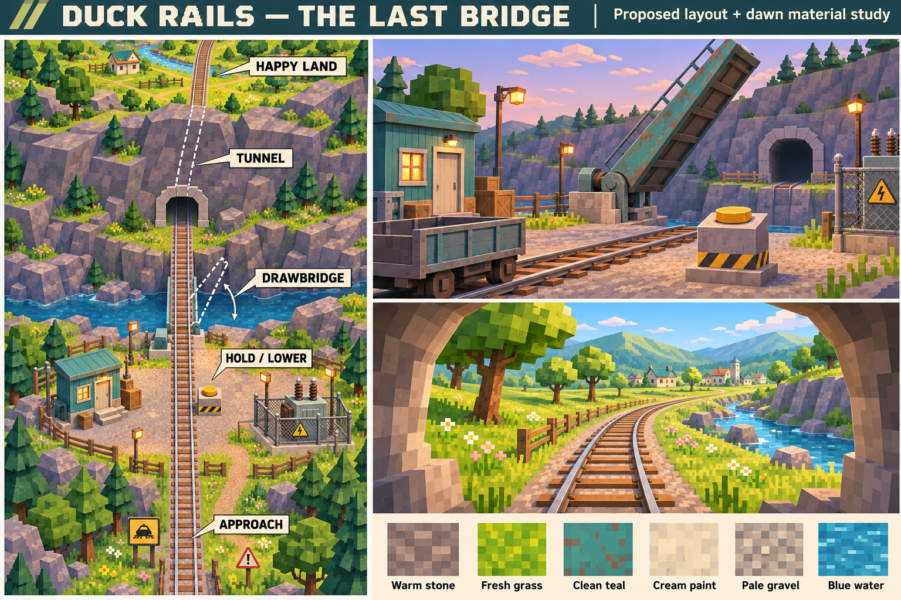

# Final escape block — concept V1

## Steel drawbridge and river recovery — November 6

User requested finished bridge geometry, walls closing the exposed riverbank gaps, and escape stairs on the fortress bank only. Installed in the existing finale prefab and synchronized Expedition scene.

The original 30 m moving hinge now carries a 7.4 m steel deck, two underslung Warren girders, crossbeams, railway rails/sleepers, panelled pedestrian shoulders, ochre edge markings and open posted Skyscraper Works handrails. Concrete abutments and steel bearings frame the hinge/landing. All moving visuals remain beneath `Bridge hinge`, use probe lighting and are excluded from static lightmap export. Existing hold, pause/resume, completion and train behavior are unchanged.

Concrete retaining walls/buttresses close the fortress bank from the river bed to terrain. The opposite bank has a rock foundation and buttresses; tall rock end walls close the lateral ground-plane edges. Two solid concrete switchback staircases, one on each side of the bridge, return exclusively to the fortress. Each has two 29-step flights, 3 m width, approximately 0.198 m rise per tread, a turning landing at -5.75 m and an upper landing at ground level. Posts are seated on individual stair treads. Stairs occupy Z81.5–90; there is no staircase onto the tunnel bank. The river retains its solid recovery floor at -11.5 m, with a blue pixel surface and sparse ripple details; no swimming/drowning mechanics were added. Combat bounds and graph footprint retain the approved fortress encounter; these are player recovery routes.

[1,036 river/bridge checks](validation/finale-fort/river-checks.txt) pass: every tread and landing has support/body clearance, posts are grounded, both banks close the gap, bridge shoulders and train envelope are clear, and 17 sampled hinge angles have no significant penetration into fixed geometry. [791 retained fortress checks](validation/finale-fort/traffic-checks.txt) and all 17 bridge-hold regressions pass. Graph/lighting rebuilt offline, river-level probes added, and Expedition bindings synchronized. Physical headset recovery, real-client multiplayer and Quest performance remain unverified.

Editor previews use temporary review lighting: [raised bridge and river](../output/finale-fort/bridge-raised.png), [lowered bridge](../output/finale-fort/bridge-lowered.png), [recovery staircase](../output/finale-fort/river-recovery.png). Reproduce geometry checks by running `validation/finale-fort/river-command.cs.txt` in the finale Bake scene; temporary hinge poses are restored and the saved scene should be reopened afterward.

Both actual route-loader Play Mode rounds (seeds 0/7) pass all 42 assertions with this bridge/river version, including moving-span exclusion, lighting bindings, translated probes and cleanup (3,768 assembled probes). [Runtime evidence](validation/finale-fort/runtime/runtime-proof.txt). The only Console error in this run was the existing Meta XR no-headset `ErrorFormFactorUnavailable`; it did not prevent the offline proof. The separate Canyon marker issue noted below was not retested in this art pass.

## Single walkway, open rails and traffic jam — November 6

User explicitly requested removal of the northern non-button walkway, open railings matching Skyscraper Works with supported posts, and an approach traffic jam replacing trees/crates. Installed changes supersede the earlier second-loop/parapet decisions below.

Only the original cross-track button catwalk remains. Both northern towers stay accessible from their respective side landings; exposed edges left by removing the second span are guarded. All generated fortress parapets, including tower observation walls above deck level, are removed in favor of 1.1 m open rails, midrails and posts spaced at most 3 m. Uses the exact `SkyscraperWorks/Crane ochre.mat` and `Scaffold steel.mat` assets. Solid supporting concrete and containment walls remain below/away from the open railings.

Approach trees and supply crates removed. Added 37 static cars/trucks plus one static tank, in dense skewed queues on both sides of the railway; selected cars are overturned. Geometry follows existing local low-poly vehicle authoring patterns. No driving, weapons, physics simulation or loot behavior added. Happy Land vegetation unchanged.

[717 geometry/navigation checks](validation/finale-fort/traffic-checks.txt) pass: only one crossing, no parapet remnants, removed approach props, grounded vehicles, exact railing materials and supported posts, reachable tower/button samples and train clearance. [Traffic preview](../output/finale-fort/traffic-jam.png) | [button walkway](../output/finale-fort/button-deck.png). Final bake/runtime validation noted below; headset readability/traversal, network and Quest performance remain pending.

Before editing, the unsaved Expedition state was preserved in `Assets/DuckRails/FinaleFort/Backups/BeforeTraffic-20261106-100413.unity` and the active scene saved. This snapshot is not a build scene.

Final validation: offline graph and lighting rebuilt/exported, Expedition synchronized, and both route-loader Play Mode rounds passed all 42 assertions (seeds 0/7), including bindings, translated probes and cleanup. [Runtime evidence](validation/finale-fort/runtime/runtime-proof.txt) now reflects this single-walkway/traffic version. No multiplayer/headset acceptance is implied.

## Concrete fortress correction — November 6

User rejected the stilt-supported, timber-like appearance and requested the concrete fortress from the approved concept. Reworked the authoring geometry: solid south bastion and patrol-wall bases; north bunker side/rear walls with ground-level entrance openings; solid stair masses; solid tower bases and thick concrete roofs; broad concrete abutments replacing slender deck posts; concrete parapets with restrained teal caps. Railway and catwalk walking envelopes, both towers, northern link and off-path button balcony remain.

Dedicated pale grey point-filtered concrete and muted teal materials replace the dark inherited surface treatment on fortress architecture; the approach yard has a darker grey concrete variant. These materials are local to the finale. Existing material assets remain available; no shared source textures were changed. [724 concrete geometry/navigation checks](validation/finale-fort/concrete-checks.txt) pass. Lighting and runtime evidence are recorded with the final update below. Headset traversal/visual acceptance, multiplayer and performance remain open.

Final correction validation: navigation and lighting rebuilt/exported, Expedition synchronized, and both offline route-loader rounds passed all 42 assertions with the corrected geometry (3,708 probes across the assembled route). [Current editor preview](../output/finale-fort/fortress.png) shows the solid concrete treatment; [runtime evidence](validation/finale-fort/runtime/runtime-proof.txt). Earlier stilt-supported captures have been replaced by current captures.

## Northern lookout towers — November 6

User explicitly requested northeast/northwest fortress lookout towers connected by a walkway. Installed two roofed 8 x 8 m observation towers centered at local X±34/Z74, deck Y8, canopy top Y11.85. Concrete corner piers, parapets and guards retain open views; inner 3 m portals connect to the existing lookout landings. Existing stairs provide access from both bastions.

A new 3 m-wide northern walkway at Z72.5–75.5 crosses between the old lookout landings, continuing through short side links to both towers. It forms a second upper loop alongside the original button catwalk. The central off-path hold-button balcony, bridge movement and 300 m ending flow remain unchanged. No supports enter the railway envelope.

The updated towers also passed both offline route-loader Play Mode rounds (42 assertions, seeds 0/7), including exported lighting bindings, finale probe movement, replacement and teardown. Evidence: [runtime proof](validation/finale-fort/runtime/runtime-proof.txt).

Offline navigation and lighting rebaked; prefab and Expedition scene synchronized. [724 geometry/navigation checks](validation/finale-fort/tower-checks.txt) pass, including continuous tower-to-tower support/body clearance, every tower access stair tread, tower reachability, original catwalk and train clearance. [Updated editor overview](../output/finale-fort/fortress.png). Headset traversal, multiplayer and performance acceptance remain pending.

## Installed rough fortress and Happy Land — November 6

User approved implementation of the full flow, explicitly retaining the detailed fortress/catwalk-button plan rather than the simplified full-route thumbnail. Installed in `Assets/DuckRails/Blocks/bridge-finale-v1.prefab` and synchronized Expedition's actual finale and bridge references. Authoring: `Assets/Editor/RailFinaleFort.cs`; menu `Duck Rails/Authoring/Finale/Install approved fortress and valley`. Week 3 builder now preserves this authored finale.

The encounter has paired +2 m south bastions, +4 m north bastions and side patrol decks, stairs to +8 m lookouts/cross-track catwalk, ten optional jump plinths, undercrofts, containment walls and separated approach openings. The 4 x 2.5 m balcony projects north from the middle of the 3 m-wide catwalk; existing physical hold control moved to local (0,9.05,71.1), outside its through-lane. The 300 m route, Z55 stop, Z80 bridge hinge and Z120–160 tunnel footprint remain. Tunnel roof raised for the tested 6.3 m train envelope. No runtime gameplay scripts or hold/finish rules changed.

Happy Land has saved point-filtered pixel material variants, faceted trees/blossoms, orchard rows, four simple cottage exteriors, flower markers and a stream ribbon. A continuous authored terrain mesh encloses the valley on both sides; the far ridge rises beyond Z320, outside the declared 300 m ride layout. Scenery is a rough blockout, not finished art. The tunnel ridge uses rough block masses. Final atmosphere is still owned by Expedition; temporary bright capture lighting is not gameplay lighting.

Validation: verified MCP target `X:/Work/duck-rails/Assets`; Unity scripts compiled, offline crawlgraph and lighting baked/exported. [364 geometry/navigation checks](validation/finale-fort/geometry-checks.txt) pass (train clearance outside moving span, catwalk body clearance, nine reachable level/button samples, route/control placement). All 17 existing bridge-hold regression checks passed. [Two actual route-loader Play Mode rounds](validation/finale-fort/runtime/runtime-proof.txt), seeds 0 and 7, passed 42 assertions including lighting bindings, moving-bridge exclusion, translated finale probes, replacement and cleanup. Saved repeatable scene: `Assets/DuckRails/FinaleFort/RuntimeProof.unity`.

Limits/issues: broad Week 3 catalogue regression stopped at `canyon-v1 reusable coal marker instances`; no Canyon assets were changed here. Play Mode logged Meta XR `ErrorFormFactorUnavailable` without a headset; the offline route proof nevertheless completed. Natural stair/jump traversal, control reach and return timing, enemy pursuit/defense balance, actual victory-ride edge concealment from all player positions, real-client networking and Quest frame-time/memory remain unverified. Do not mark the finale milestone fully accepted from these editor checks.

Editor captures: [fortress](../output/finale-fort/fortress.png), [button balcony](../output/finale-fort/button-deck.png), [Happy Land](../output/finale-fort/happy-land.png), [full site](../output/finale-fort/full-layout.png). Capture helper `RailFinaleFortCapture.Capture()` uses temporary review lighting and restores the saved bake scene.

## V5 — full 300 m finale and enclosed Happy Land, November 6

[Full layout with side hills and far ridge](../output/imagegen/final-escape-v5/full-layout-hills.png) | [Earlier open-valley layout](../output/imagegen/final-escape-v5/full-layout.png) | [Built-in generation prompts](../output/imagegen/final-escape-v5/prompts.txt). Generated illustration conveys landscaping intent; terrain perspective and proportions are illustrative, not measured projections.

User endorsed the full-route layout and explicitly requested hills along Happy Land's left, right and far end to hide the ground-plane edges. This is confirmed art direction; terrain shape and heights remain proposed, with no Unity build authorized by this drawing discussion.

Existing route references: bridge-finale-v1.prefab declares length 300 and a straight track from local Z0 to Z300. RailWeek3Builder translates the Week 2 finale by -470 m: bridge begins at local Z80 with a 30 m span; tunnel is local Z120–160; suggested stop is Z55. This leaves 140 m after the tunnel within the declared block length. Existing far-bank geometry extends beyond the declared route end; use the route extent for planning, not the ground mesh edge as the ending destination.

Proposed full sequence: wooded approach Z0–30; containment arena Z30–80; bridge Z80–110; far-bank approach Z110–120; tunnel Z120–160; meadow reveal Z160–195; stream/orchard Z195–250; village gardens Z250–300. Preserve the central catwalk's off-path button balcony. The original small-yard diagrams are superseded as the active concept.

Happy Land should form a sheltered green valley. Continuous overlapping low-poly grassy hill masses along both sides and a taller far-end ridge conceal the finite ground plane from the moving train, including elevated players. Keep the railway corridor and views across the valley floor open. Place orchards, stream and village below the slopes; do not use a flat tree billboard as the sole edge screen. Exact hill elevations/setbacks and the visual closure beyond the existing rail endpoint must be checked against the complete automatic-ride travel and player sightlines before implementation. Do not add a collision obstruction in the train's required travel envelope or silently change ride timing. No runtime terrain generation or new gameplay is implied.

All scenery, fortress heights, and terrain footprints remain layout proposals. No scene, prefab, navigation, lighting or materials changed.

## V4 — central catwalk button deck, November 6

User likes the fortress concept and requests the hold button on a small projecting deck at the middle of the cross-track overhead walkway, leaving its through-path unobstructed. This supersedes the V3 near-right terrace control location.

[Revised top-down / 3D sheet with close-up](../output/imagegen/final-escape-v4/button-deck.png) | [Exact edit prompt](../output/imagegen/final-escape-v4/prompt.txt)

The drawing proposes a bridge-facing balcony, flush with the catwalk, open along its walkway connection and guarded on three outer edges. The operator stands off the circulation lane facing the drawbridge; the yellow console is at the balcony's outer edge. Approach remains possible from both ends of the catwalk. The earlier terrace button is removed. Balcony proportions are illustrative (prompt suggested approximately 3 by 2 m), not approved dimensions. Existing V3 elevation/connection ambiguities still require a measured plan and train clearance checks. No Unity implementation.

## V3 — containment fortress arena, November 6

User requests a concrete arena with many platforms and levels inspired by Skyscraper Works, without full skyscrapers. High-security fortress fiction: people built it to contain zombies. This is the active exploration; exact layout remains unapproved.

[Top-down and 3D concept sheet](../output/imagegen/final-escape-v3/containment-fort.png) | [Built-in generation prompt](../output/imagegen/final-escape-v3/prompt.txt)

Proposed: broad concrete bastions flank the railway, ground undercrofts, +2 m/+4 m terraces, side walkways, two small +8 m lookout decks and an overhead security crossing. Stairs provide ordinary circulation/recovery, while low stepping platforms offer optional jumps. Breached approach-side entrances and inward-facing floodlights convey abandoned containment infrastructure. No new enemy count, weapons or puzzles.

The sheet places the button on the near-right +2 m terrace, with a short stair return to the train, rather than the prompt's initial far-right placement. This is a useful alternative for review. Preserve two approaches to the operator. Only the drawbridge crosses the gorge, followed by tunnel and concealed dawn reveal.

Generated top view and perspective are spatial studies, not measured matching geometry. The catwalk's +8 m label/7 m clearance are proposed targets and do not consistently agree with the drawn terrace connections. Resolve elevations, stair connections and train/passenger clearance in a measured plan before implementation. Heights, jump spacing, guards, footprint and navigation remain pending. No Unity changes or gameplay validation performed.

## Button-area render alternatives — November 6

Follow-up: [true top-down comparison](../output/imagegen/final-escape-v2/top-down-comparison.png) diagrams all three waiting spaces with shared bridge/track orientation, yellow controls, blue reboarding routes and red possible enemy approaches. Individual plans: [keeper yard](../output/imagegen/final-escape-v2/plan-1.png), [machinery terrace](../output/imagegen/final-escape-v2/plan-2.png), [checkpoint](../output/imagegen/final-escape-v2/plan-3.png). These are schematic, not to scale, and focus on the near-bank space rather than the complete finale block. No dimensions, spawn locations or layout approval are implied.

User requested three game-like low-poly pixel-textured 3D render concepts, rather than concept drawings. All remain proposals; no layout selected or Unity assets changed.

- [Bridge keeper's yard](../output/imagegen/final-escape-v2/keepers-yard.png): exterior hut console, gravel loop, shed and utility enclosure.
- [Machinery terrace](../output/imagegen/final-escape-v2/machinery-terrace.png): exposed concrete apron, freestanding control and large bridge mechanism.
- [Boundary checkpoint](../output/imagegen/final-escape-v2/boundary-checkpoint.png): covered office control opposite maintenance garage and inspection shelter.

These are generated visualizations, not Unity screenshots. Bridge/track alignment in the images is illustrative and includes generation inconsistencies, especially the checkpoint's apparent continuous track beneath the raised leaf; any measured plan must restore one continuous railway carried by the lowered span with no bypass. Train depictions are scale placeholders, not replacements for the approved train. [Exact built-in generation prompts](../output/imagegen/final-escape-v2/prompts.txt).

November 6, 2026. Proposal for review; no Unity changes or production materials created.

User direction: the final block has a held button that lowers the bridge, followed by a tunnel and happy land beyond Quackville. Match the other blocks while making this location brighter; a separate material/texture family is an option.

## Proposed art direction

Keep the low-poly forms and coarse pixel textures. Approach through a brighter predawn railway utility yard, cross a weathered teal drawbridge over a river gorge, enter a rocky ridge tunnel, then emerge into a sunny green valley. Pale stone, cream trim, leafy trees, small flower patches and distant cheerful houses establish relief. The village and river are proposed scenery, not new destinations or gameplay.

The bridge is the main landmark. Place the external button on the near bank with sightlines toward the span, room for defending teammates and a short unobstructed return to the stopped train. A small maintenance hut and fenced electrical pad provide supporting silhouettes. Spread trees, paths and rock terraces through the approach and departure areas. Preserve railway clearance and flat connection seams. No alternate crossing bypasses the bridge.

The image's left panel is an illustrative oblique site overview, not a measured top-down drawing. Exact footprint, span, tunnel length, clearances and control placement remain pending a measured plan and user review before blockout. The raised-span illustration and perspective train are mood references, not mechanical or asset specifications.

## Material proposal

Create a small companion dawn atlas if needed: fresh grass, warm rock/concrete, pale gravel and cream paint. Retain the existing pixel density and simple matte treatment; reuse railway steel and existing compatible surfaces. Brighter albedo and softer dawn lighting should work together. The six image swatches are palette studies, not seamless textures or UV-ready assets. Keep the approach cooler than the post-tunnel valley and conceal the full lighting transition inside the tunnel; avoid a white exposure flash.

## Gameplay retained

Manual braking remains necessary. Hold advances lowering; release pauses and retains progress; full lowering locks the span down. Existing initial tuning is 30 seconds. No extra switches, fuses or puzzles. Keep both-side enemy approach space under the current encounter direction. Bridge entry records finish status and starts the automatic ride; the tunnel hides the dawn transition. The new art must preserve these behaviors and leave a readable view for the existing results presentation.

## Review and next steps

Choose or revise the visual direction, then prepare a measured top-down layout for approval before rough Quackville blockout. Production texture work, Unity installation, navigation/lighting bakes and headset/network validation remain unperformed.

Generated using the built-in image generation tool. [Exact prompt](../output/imagegen/final-escape-v1/prompt.txt). References: [art guide](art-guide.md), [game design](game-design.md), [bridge hold](bridge-hold.md).
