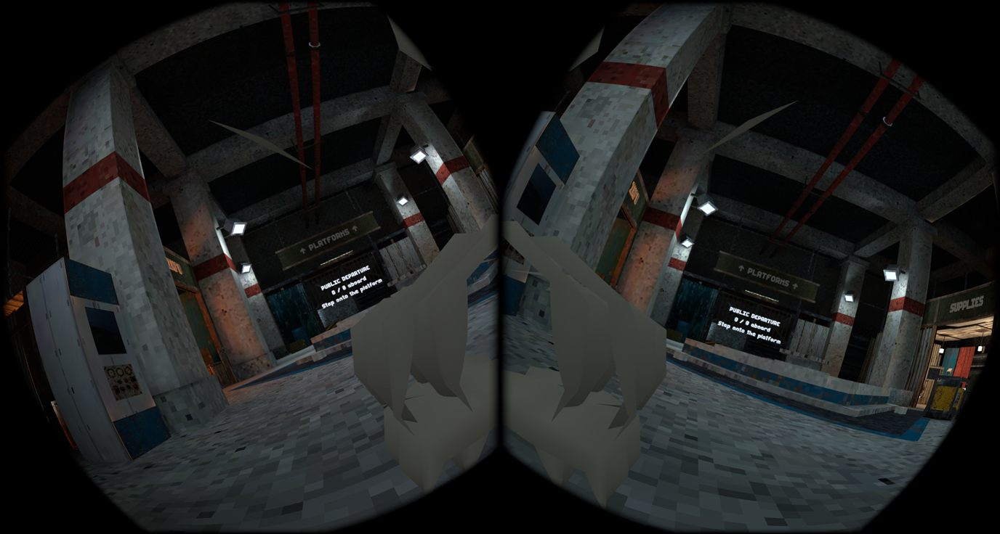

# Production build gate: Quest APK, static check and launch (November 21–22, 2026)

Queue entry: [Production build gate for admin test tools](../../../playtest-queue.md#production-build-gate-for-admin-test-tools--2026-11-20).
These are automated checks only. No headset wearer, admin sign-in or gameplay input was involved.

## Build

- Entry point: the same steps as `DuckzBuildWindow.Build` (Meta patch check, `GetSigningError`, enabled Build Settings scenes, `BuildOptions.None`), run synchronously through Unity MCP. Afterwards `EditorUserBuildSettings.development=false` and `buildAppBundle=false` were restored to their previous values.
- Version 0.4.0, bundle code 400, Photon AppVersion `0.4_dra2`. These come from `DuckzBuildVersioning` and were already the working-tree values. `ProjectSettings.asset`, `PhotonServerSettings.asset` and `EditorBuildSettings.asset` are byte-identical to the copies taken before the build. No keystore, version or target-SDK changes were made.
- Preprocess: `Runtime logging policy passed.` (LoggingPolicyBuildCheck). Android scripting defines contain no `DEVELOPMENT_BUILD` or `DUCKZ_DIAGNOSTICS`.
- Attempt 1 (17:40–17:45 MST, about 4.5 min including IL2CPP): Gradle `:launcher:packageRelease` failed with `PackageAndroidArtifact$IncrementalSplitterRunnable` and gave no nested cause. Unity's modal "Build failure" dialog then stalled MCP until 18:17. The `ExpiredTargetSdkVersion` lint message (targetSdk 32) is not fatal. The exported `launcher/build.gradle` already sets `lint { abortOnError false }`, and `lintVitalRelease` completed.
- Rerunning `:launcher:packageRelease --stacktrace` by hand on the same exported Gradle project succeeded in 5 s, so the failure was a transient packaging problem. Unity build attempt 2 then succeeded: 0 errors, 31 s, Gradle up to date. Unity build GUID `aa81e6deda534d6ab88023aac5754b56`.
- Output: `duckrails_0.4.0_400.apk`, 179,877,273 bytes, SHA256 `5c006c725e1f14b39aea2ed5b466c78d971f7e0732f5c055587574600304457d`. The APK sits beside this file but is not in git (`*.apk` ignored). IL2CPP/managed backup and Burst symbols are in the uncommitted `output/production-gate-2026-11-22/` folder.
- On device: Unity reports `Build type 'Release'`, IL2CPP, stripping enabled. Package flags do not include `DEBUGGABLE`. `adb install -r` over the existing signed 0.4.0 install succeeded, so the signing key is the same.

## Static gate verdict: PASS

Checked: the stripped `Managed/Assembly-CSharp.dll`, the IL2CPP `Assembly-CSharp*.cpp` and `global-metadata.dat` extracted from the APK.

- Absent everywhere: `admin-coal`, `admin-train-speed` and `rails.adminTools` request/property literals; `PauseMenu.BindTestButtons`/`BindTestButton`/`RefreshTestLabels`; `RailAdminTools.Refresh`, `ToggleNoClip`, `ToggleInvincibility`, `ToggleTrainSpeed`, `RailAdminTools.DepositCoal`; `NewPlayer.UpdateAdminFlight` and its flight state. Also absent: the Test button names `Deposit1`, `Deposit50` and `TrainSpeed`.
- Present, as expected for release: `RailAdminTools` keeps only the `#else` stubs `get_Available`, `get_NoClip` and `get_Invincible`. In IL2CPP, `get_Available` is `return (bool)0;`. `NewPlayer.RestoreAdminFlight` is the empty release stub. `RailTestTools.DepositCoal` is the Test Center path. It is guarded by `CanMutate`, which requires `RailDiagnostics.Development`, which is `isEditor || RailAdminTools.Available`, so it is false on device.
- Pause menu: `Awake` takes the release branch that deactivates `testButton`/`testPage`, and `Update` has no admin refresh. The R3 `ToggleNoClip` block in `NewPlayer.Update` is compiled out.
- Present, as expected: `SettingsMenu.OnSubmitBug`, the `SubmitBug`/`SubmitBugStatus` names and the normal `gather` request.

Raw scan output:

```
symbol                     dll   metadata  il2cpp
-- GATED (expect absent in release)
admin-coal                 no    no        no
admin-train-speed          no    no        no
rails.adminTools           no    no        no
BindTestButtons            no    no        no
BindTestButton             no    no        no
RefreshTestLabels          no    no        no
ToggleNoClip               no    no        no
ToggleInvincibility        no    no        no
ToggleTrainSpeed           no    no        no
UpdateAdminFlight          no    no        no
adminFlying                no    no        no
InvincibilityOverridden    no    no        no
-- CONTROL (expect present)
RailAdminTools             yes   yes       yes   (stubs only: get_Available/get_NoClip/get_Invincible)
OnSubmitBug                yes   yes       yes
SubmitBugStatus            yes   yes       yes
gather                     yes   yes       yes
```

The `dll` column covers metadata names and UTF-16 string literals. `DepositCoal` matches only `RailTestTools.DepositCoal`, and `RestoreAdminFlight` matches only the empty stub. Both are explained above.

## Launch on Quest 3 (serial 2G0YC0RF0D002Z): PASS, with minor findings

- The headset was not worn. Proximity was simulated with `vrpowermanager.prox_close`; the original state was `set_proximity_close=false` and `prox_far` was restored afterwards. The app was launched with `am start` at 18:21:16 MST and logcat was captured for about 125 s. [logcat excerpt](logcat-excerpt.txt). Tokens, IDs and the attestation payload were removed.
- Result: Horizon Platform initialised, platform/backend sign-in proceeded without credentials typed, and the Compound loaded. Screenshots show the Public Departure board reading "0 / 8 aboard". There was no FATAL EXCEPTION, ANR, native crash or missing-asset error, and no Photon errors were logged. Release builds compile out routine `DuckzLog` traces, so Photon connection progress is not visible in logcat. The frame rate settled at 72/72 FPS. The app was force-stopped after capture.
- Finding 1: one `Backend response could not be read: JSON parse error: Invalid value.` (`DuckzApiClient.Parse`) at startup. The endpoint is not identifiable from release logs, and nothing user-visible followed in the 2 minutes. Worth checking which call received a non-JSON body.
- Finding 2: CutePixel SDF has no U+2014 (em dash). TMP replaced it with a space 51 times in the Compound leaderboard/stats text objects `[Duck]`, `[Escapes]`, `[Total]`, `[Winner]` and `[Details]`. This is cosmetic.
- Other warnings are the usual Meta SDK/OpenXR ones (MRC lib, boundary visibility, unsupported extension functions) and a GameAnalytics `AppSet` NoClassDefFoundError, which is handled.



## Still needs Justin in the headset

See the queue entry. The production build is left installed as `com.gunraiders.duckrails` 0.4.0 (400).
